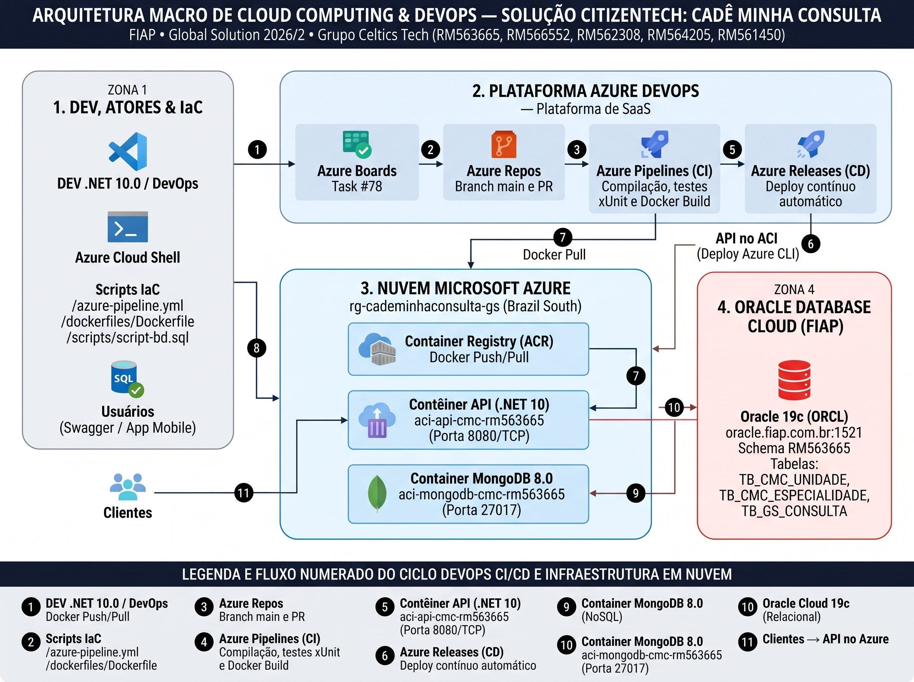

# Cadê Minha Consulta — Solução CitizenTech (.NET 10, DevOps & Cloud Computing)

**FIAP • 2º Ano Análise e Desenvolvimento de Sistemas • Global Solution 2026/2 (CitizenTech)**  
**Disciplina:** DevOps Tools & Cloud Computing (Integrada com Advanced Business Development with .NET, Compliance, Quality Assurance & Tests e Mastering Relational and Non-Relational Database)  
**Grupo:** Celtics Tech

---

## 1. Identificação da Equipe (Grupo Celtics Tech)

| Nome Completo do Integrante | RM | Turma | Responsabilidade no Projeto |
| :--- | :---: | :---: | :--- |
| João Victor Vendrameto | 563665 | 2TDSPV | Cloud & DevOps Engineer / Provisionamento IaC & Pipelines CI/CD |
| Gabriel Ambrósio Saraiva | 566552 | 2TDSPV | Scrum Master / Arquitetura Cloud & Banco de Dados |
| Vinicius Romaguera Cardozo | 562308 | 2TDSPX | Backend Developer / Modelagem Relacional e NoSQL |
| Nicolas de Oliveira Jacob | 564205 | 2TDSPX | Backend Developer / Integração de Endpoints e Contratos |
| Yuri Fuzinatto Garzoli Barreto | 561450 | 2TDSPX | .NET Lead Developer / Segurança JWT, Idempotência & Testes xUnit |

* **Link da Organização no Azure DevOps:** https://dev.azure.com/rm563365/CadeMinhaConsulta-DevOps
---

## 2. Conceito da Solução Proposta (CitizenTech — ODS 3 e ODS 10)

A solução **Cadê Minha Consulta** é uma plataforma **CitizenTech** desenvolvida para combater o absenteísmo em consultas e exames especializados do Sistema Único de Saúde (SUS) e permitir o reaproveitamento automático de vagas liberadas:

* **Problema Real:** O índice de faltas em consultas e exames especializados na rede pública varia entre 25% e 38%, motivado pelo desconhecimento do agendamento (61,2%), esquecimento (23,5%), dificuldades de deslocamento (29,0%) e cadastros telefônicos desatualizados (14,5%).
* **Solução Tecnológica:** Backend em nuvem desenvolvido em **ASP.NET Core 10 Minimal API**, integrando persistência poliglota em nuvem (**Oracle Database 19c Cloud** e **MongoDB 8.0 Container**) para gerenciar unidades de saúde (UBS/AME com código CNES), especialidades e valores da tabela SUS/SIGTAP, regras de lembrete com controle estrito de idempotência e notificações sincronizadas das consultas dos cidadãos.
* **Alinhamento com os ODS da ONU:** **ODS 3** (Saúde e Bem-Estar) e **ODS 10** (Redução das Desigualdades).

---

## 3. Desenho Macro da Arquitetura Cloud & Fluxo DevOps CI/CD

O desenho macro da arquitetura foi estruturado por zonas de infraestrutura em nuvem (**Zona 1:** Dev, Atores & IaC; **Zona 2:** Plataforma Azure DevOps; **Zona 3:** Nuvem Microsoft Azure `rg-cademinhaconsulta-gs` em `Brazil South`; **Zona 4:** Oracle Database Cloud FIAP), conforme imagem versionada em `docs/arquitetura-macro-cloud.jpg`:



### 3.1 Fluxo Numerado da Arquitetura (Etapas 1 a 11 do Diagrama)

1. **Desenvolvimento (.NET 10.0) e Planejamento no Azure Boards:** O ciclo inicia com a criação de uma Tarefa (*Work Item Task*, como a `Task #78`) no **Azure Boards** (processo Scrum) e a implementação do código C# (`.NET 10.0`), testes `xUnit`, `Dockerfile` e scripts de infraestrutura no VS Code.
2. **Versionamento Git e Políticas de Branch no Azure Repos:** Uma nova branch é criada a partir da Task. A branch principal `main` possui políticas ativas de proteção: revisor obrigatório (mínimo 1), autoaprovação habilitada para simulação, vinculação obrigatória de Work Item e revisor padrão automático (`RM563665`).
3. **Acionamento da Pipeline de Build (CI):** Após a aprovação e conclusão do *Merge* via *Pull Request* na branch `main`, a pipeline declarativa `/azure-pipeline.yml` é acionada automaticamente em agente Linux (`ubuntu-latest`).
4. **Compilação, Testes Automatizados xUnit e Docker Build/Push para o ACR:** A Pipeline de CI instala o SDK do `.NET 10.0`, restaura pacotes NuGet, compila a solução em modo `Release`, executa automaticamente os **47 testes automatizados xUnit** (publicando os resultados na aba *Tests*) e realiza o `docker build` e `docker push` da imagem `cademinhaconsulta-api:latest` para o **Azure Container Registry (`acrcademinhaconsultarm563665.azurecr.io`)**.
5. **Publicação de Artefatos e Gatilho Contínuo para Release (CD):** A Pipeline de CI empacota a aplicação junto com as pastas `/scripts` e `/dockerfiles` no artefato `drop`, disparando automaticamente o gatilho de implantação contínua (*Continuous Deployment Trigger*).
6. **Deploy Automático pela Pipeline de Release (CD) no Azure ACI:** A pipeline `CadeMinhaConsulta-Release-CD` autentica na assinatura Azure por meio da Service Connection `Azure-Gabriel-GS` e executa a tarefa **Azure CLI**, provisionando/atualizando o container da API no **Azure Container Instances (ACI)** e injetando as variáveis de ambiente e strings de conexão secretas.
7. **Pull da Imagem Containerizada (ACR para ACI):** O serviço **Azure Container Instances (`aci-api-cmc-rm563665`)** realiza o `Docker Pull` da imagem atualizada diretamente do registro privado `acrcademinhaconsultarm563665.azurecr.io`.
8. **Provisionamento de Infraestrutura como Código (Scripts IaC):** O script `/scripts/provisionar-infra.azcli` cria via Azure Cloud Shell (Azure CLI) o grupo de recursos `rg-cademinhaconsulta-gs`, o registro ACR e as instâncias de container no Azure, enquanto o script `/scripts/script-bd.sql` estrutura os objetos DDL no banco Oracle.
9. **Persistência NoSQL em Nuvem (MongoDB 8.0 no Azure ACI):** A API `.NET 10` comunica-se na porta TCP `27017` com o container `aci-mongodb-cmc-rm563665` (`cmc-mongo-rm563665.brazilsouth.azurecontainer.io`), persistindo documentos nas coleções `reminder_rules` (com chave de idempotência SHA-256) e `notifications`.
10. **Persistência Relacional em Nuvem (Oracle Database Cloud FIAP):** A API `.NET 10` conecta-se via driver gerenciado `ODP.NET Core` / `Entity Framework Core` na porta TCP `1521` ao banco `oracle.fiap.com.br` (`SID: ORCL`, Schema `RM563665`), executando o CRUD completo nas duas tabelas relacionais **`TB_CMC_UNIDADE`** e **`TB_CMC_ESPECIALIDADE`** e consultando agendamentos em **`TB_GS_CONSULTA`**, com comprovação de persistência via comando `SELECT` direto no Oracle SQL Developer.
11. **Consumo pelos Clientes em Nuvem (Porta 8080):** O aplicativo Mobile React Native, os gestores de unidades de saúde e a interface interativa do **Swagger UI** consomem a API publicamente na porta `8080` (`http://cmc-api-rm563665.brazilsouth.azurecontainer.io:8080/swagger/index.html`).

### 3.2 Legenda dos Recursos Provisionados em Nuvem

| Recurso / Serviço | Nome / Identificador em Nuvem | Tipo / Tecnologia | Região / Host |
| :--- | :--- | :--- | :--- |
| **Resource Group** | `rg-cademinhaconsulta-gs` | Grupo Lógico de Recursos Azure | `Brazil South` |
| **Container Registry (ACR)** | `acrcademinhaconsultarm563665` | Registro Privado Docker (`Basic`) | `acrcademinhaconsultarm563665.azurecr.io` |
| **Container da API (ACI)** | `aci-api-cmc-rm563665` | ASP.NET Core 10 Minimal API (Linux, 1 vCPU, 1.5 GB) | `cmc-api-rm563665.brazilsouth.azurecontainer.io:8080` |
| **Container NoSQL (ACI)** | `aci-mongodb-cmc-rm563665` | MongoDB 8.0 Community Container (Linux) | `cmc-mongo-rm563665.brazilsouth.azurecontainer.io:27017` |
| **Banco Relacional (PaaS)** | `ORCL` (Schema `RM563665`) | Oracle Database 19c Cloud | `oracle.fiap.com.br:1521` |

---

## 4. Estrutura de Diretórios e Arquivos Obrigatórios do Repositório

```text
CadeMinhaConsulta-DevOps/
├── azure-pipeline.yml                         # Pipeline YAML de CI na raiz (Requisito 13)
├── CadeMinhaConsulta.slnx                     # Arquivo de Solução .NET 10.0
├── README.md                                  # Documentação da solução, arquitetura e JSONs de CRUD
├── .gitignore                                 # Filtro de arquivos temporários, binários e segredos locais
├── dockerfiles/                               # Pasta obrigatória de Dockerfiles (Requisito 12)
│   └── Dockerfile                             # Multi-stage build (.NET 10.0 SDK e ASP.NET Core 10.0 Runtime)
├── docs/                                      # Documentação técnica complementar e diagrama de arquitetura
│   ├── arquitetura-macro-cloud.jpg            # Imagem do Desenho Macro da Arquitetura Cloud e CI/CD
│   ├── Arquitetura.md
│   ├── Contrato-Mobile.md
│   ├── Oracle-DBv3.md
│   ├── Roteiro-Demonstracao.md
│   └── Validacao-DotNet.md
├── scripts/                                   # Pasta obrigatória de scripts de banco e nuvem (Requisitos 09, 10 e 11)
│   ├── script-bd.sql                          # DDL das tabelas Oracle, INSERTs iniciais e SELECTs de validação
│   ├── provisionar-infra.azcli                # Script Azure CLI para provisionamento de RG, ACR e Containers ACI
│   └── crud-tabelas.json                      # Payloads JSON estruturados para execução dos CRUDs
├── src/
│   └── CadeMinhaConsulta.Api/                 # Projeto principal da API (.NET 10.0)
│       ├── CadeMinhaConsulta.Api.csproj
│       ├── Program.cs                         # Inicialização, DI, Swagger, Rate Limiting, JWT, HealthChecks e Rotas
│       ├── Features/
│       │   ├── OracleCrud/
│       │   │   └── OracleCrudEndpoints.cs     # CRUD completo nas 2 tabelas Oracle (TB_CMC_UNIDADE e TB_CMC_ESPECIALIDADE)
│       │   ├── Notifications/
│       │   │   ├── Notification.cs
│       │   │   └── NotificationEndpoints.cs   # Sincronização de notificações Oracle -> MongoDB
│       │   └── ReminderRules/
│       │       ├── ReminderRule.cs
│       │       └── ReminderRuleEndpoints.cs   # CRUD idempotente de regras de lembrete no MongoDB
│       └── Infrastructure/
│           ├── DatabaseHealthChecks.cs
│           ├── JwtAuthentication.cs
│           ├── MongoNotificationStore.cs
│           ├── MongoReminderRuleStore.cs
│           ├── OraclePatientAppointments.cs
│           ├── OracleReadDbContext.cs
│           └── SwaggerAuthorizationFilter.cs
└── tests/
    └── CadeMinhaConsulta.InfrastructureTests/ # Suíte com 47 testes automatizados xUnit executados no CI
        ├── ApiInfrastructureTests.cs
        ├── NotificationEndpointTests.cs
        ├── NotificationProjectionTests.cs
        ├── OracleMappingTests.cs
        └── ReminderRuleTests.cs
```

---

## 5. Payloads JSON para Execução Completa do CRUD (Duas Tabelas Oracle + MongoDB)

Em conformidade com os **Requisitos 14, 15 e 19** da disciplina de DevOps Tools & Cloud Computing, todas as operações de **Create, Read, Update e Delete (CRUD)** são executadas em nuvem sobre **duas tabelas relacionais no banco Oracle (`TB_CMC_UNIDADE` e `TB_CMC_ESPECIALIDADE`)** e comprovadas diretamente no banco por meio de instruções **`SELECT`** no Oracle SQL Developer.

### 5.1 Tabela 1 (Oracle Cloud): `TB_CMC_UNIDADE` — Endpoint Base: `/api/unidades`

#### 1) CREATE (`POST /api/unidades`)
* **Payload JSON de Entrada:**
```json
{
  "nome": "AME Vila Mariana",
  "cnes": "2089123",
  "cidade": "São Paulo",
  "uf": "SP"
}
```
* **Resposta HTTP Esperada (`201 Created`):**
```json
{
  "id": 2,
  "nome": "AME Vila Mariana",
  "cnes": "2089123",
  "cidade": "São Paulo",
  "uf": "SP",
  "criadoEm": "2026-11-18T18:33:54.7311398Z"
}
```

#### 2) READ (`GET /api/unidades` e `GET /api/unidades/2`)
* **Resposta HTTP Esperada (`200 OK`):**
```json
[
  {
    "id": 1,
    "nome": "AME Maria Zélia",
    "cnes": "2077485",
    "cidade": "São Paulo",
    "uf": "SP",
    "criadoEm": "2026-11-18T15:29:46"
  },
  {
    "id": 2,
    "nome": "AME Vila Mariana",
    "cnes": "2089123",
    "cidade": "São Paulo",
    "uf": "SP",
    "criadoEm": "2026-11-18T18:33:54"
  }
]
```

#### 3) UPDATE (`PUT /api/unidades/2`)
* **Payload JSON de Entrada:**
```json
{
  "nome": "AME Vila Mariana - Unidade Integrada SUS",
  "cnes": "2089123",
  "cidade": "São Paulo",
  "uf": "SP"
}
```
* **Resposta HTTP Esperada (`200 OK`):**
```json
{
  "id": 2,
  "nome": "AME Vila Mariana - Unidade Integrada SUS",
  "cnes": "2089123",
  "cidade": "São Paulo",
  "uf": "SP",
  "criadoEm": "2026-11-18T18:36:41.7245416Z"
}
```

#### 4) DELETE (`DELETE /api/unidades/2`)
* **Resposta HTTP Esperada:** `204 No Content`.

#### 5) Query SQL de Comprovação de Persistência Diretamente no Banco Oracle
```sql
SELECT ID_UNIDADE, NM_UNIDADE, CD_CNES, NM_CIDADE, SG_UF, DT_CRIACAO
FROM TB_CMC_UNIDADE
ORDER BY ID_UNIDADE;
```

---

### 5.2 Tabela 2 (Oracle Cloud): `TB_CMC_ESPECIALIDADE` — Endpoint Base: `/api/especialidades`

#### 1) CREATE (`POST /api/especialidades`)
* **Payload JSON de Entrada:**
```json
{
  "nome": "Ortopedia Adulto",
  "codigoSigtap": "0301010072",
  "valorSigtap": 10.79,
  "idUnidade": 1
}
```
* **Resposta HTTP Esperada (`201 Created`):**
```json
{
  "id": 2,
  "nome": "Ortopedia Adulto",
  "codigoSigtap": "0301010072",
  "valorSigtap": 10.79,
  "idUnidade": 1,
  "criadoEm": "2026-11-18T18:40:12.1120451Z"
}
```

#### 2) READ (`GET /api/especialidades` e `GET /api/especialidades/2`)
* **Resposta HTTP Esperada (`200 OK`):**
```json
[
  {
    "id": 1,
    "nome": "Cardiologia Clínica",
    "codigoSigtap": "0301010072",
    "valorSigtap": 10.79,
    "idUnidade": 1,
    "criadoEm": "2026-11-18T15:29:46"
  },
  {
    "id": 2,
    "nome": "Ortopedia Adulto",
    "codigoSigtap": "0301010072",
    "valorSigtap": 10.79,
    "idUnidade": 1,
    "criadoEm": "2026-11-18T18:40:12"
  }
]
```

#### 3) UPDATE (`PUT /api/especialidades/2`)
* **Payload JSON de Entrada:**
```json
{
  "nome": "Ortopedia e Traumatologia Especializada",
  "codigoSigtap": "0301010072",
  "valorSigtap": 90.36,
  "idUnidade": 1
}
```
* **Resposta HTTP Esperada (`200 OK`):**
```json
{
  "id": 2,
  "nome": "Ortopedia e Traumatologia Especializada",
  "codigoSigtap": "0301010072",
  "valorSigtap": 90.36,
  "idUnidade": 1,
  "criadoEm": "2026-11-18T18:42:05.5182910Z"
}
```

#### 4) DELETE (`DELETE /api/especialidades/2`)
* **Resposta HTTP Esperada:** `204 No Content`.

#### 5) Query SQL de Comprovação de Persistência Diretamente no Banco Oracle
```sql
SELECT ID_ESPECIALIDADE, NM_ESPECIALIDADE, CD_SIGTAP, VL_SIGTAP, ID_UNIDADE, DT_CRIACAO
FROM TB_CMC_ESPECIALIDADE
ORDER BY ID_ESPECIALIDADE;
```

---

### 5.3 Coleção NoSQL (MongoDB 8.0 no Azure ACI): `reminder_rules` — Endpoint Base: `/api/reminder-rules`

*(Protegido por autenticação JWT RS256 com papel `GESTOR` e cabeçalho obrigatório `Idempotency-Key` no `POST`)*

* **CREATE (`POST /api/reminder-rules` com Header `Idempotency-Key: regra-sus-48h`):**
```json
{
  "name": "Lembrete de Consulta 48h",
  "daysBefore": 2,
  "message": "Confirme sua consulta especializada no aplicativo Cadê Minha Consulta.",
  "isActive": true
}
```
* **UPDATE (`PUT /api/reminder-rules/{id}`):**
```json
{
  "name": "Lembrete Urgente 24h SUS",
  "daysBefore": 1,
  "message": "Sua consulta ocorre amanhã. Confirme presença ou libere a vaga para o próximo cidadão da fila.",
  "isActive": true
}
```
* **READ (`GET /api/reminder-rules`)** e **DELETE (`DELETE /api/reminder-rules/{id}`)**.

---

## 6. Variáveis de Ambiente nas Pipelines de Build (CI) e Release (CD)

Em atendimento ao **Requisito 15** e blindagem contra a **Penalidade 16**, nenhuma credencial ou senha encontra-se exposta no código-fonte. Todas as configurações sensíveis são gerenciadas como variáveis de ambiente nas Pipelines do Azure DevOps com criptografia (*Keep this value secret*):

| Escopo da Variável | Nome da Variável | Valor / Finalidade |
| :--- | :--- | :--- |
| **Build (CI) & Release (CD)** | `ACR_LOGIN_SERVER` | `acrcademinhaconsultarm563665.azurecr.io` |
| **Build (CI) & Release (CD)** | `ACR_USERNAME` | `acrcademinhaconsultarm563665` |
| **Build (CI) & Release (CD)** | `ACR_PASSWORD` | `********` (Chave secreta do Azure Container Registry) |
| **Release (CD)** | `RESOURCE_GROUP` | `rg-cademinhaconsulta-gs` |
| **Release (CD)** | `ACI_API_NAME` | `aci-api-cmc-rm563665` |
| **Release (CD)** | `DNS_API` | `cmc-api-rm563665` |
| **Release (CD)** | `ORACLE_SCHEMA` | `RM563665` |
| **Release (CD)** | `ORACLE_CONNECTION_STRING` | `********` (String de conexão ODP.NET para `oracle.fiap.com.br:1521/ORCL`) |
| **Container Runtime (ACI)** | `ConnectionStrings__Mongo` | `mongodb://cmc-mongo-rm563665.brazilsouth.azurecontainer.io:27017` |
| **Container Runtime (ACI)** | `Mongo__Database` | `cademinhaconsulta_prod` |
| **Container Runtime (ACI)** | `ASPNETCORE_ENVIRONMENT` | `Development` (Habilita a documentação Swagger UI na instância de nuvem) |

---

## 7. Comandos de Compilação e Execução dos Testes Automatizados (xUnit)

```powershell
dotnet restore CadeMinhaConsulta.slnx
dotnet build CadeMinhaConsulta.slnx --configuration Release --no-restore
dotnet test CadeMinhaConsulta.slnx --configuration Release --no-build --logger trx
```