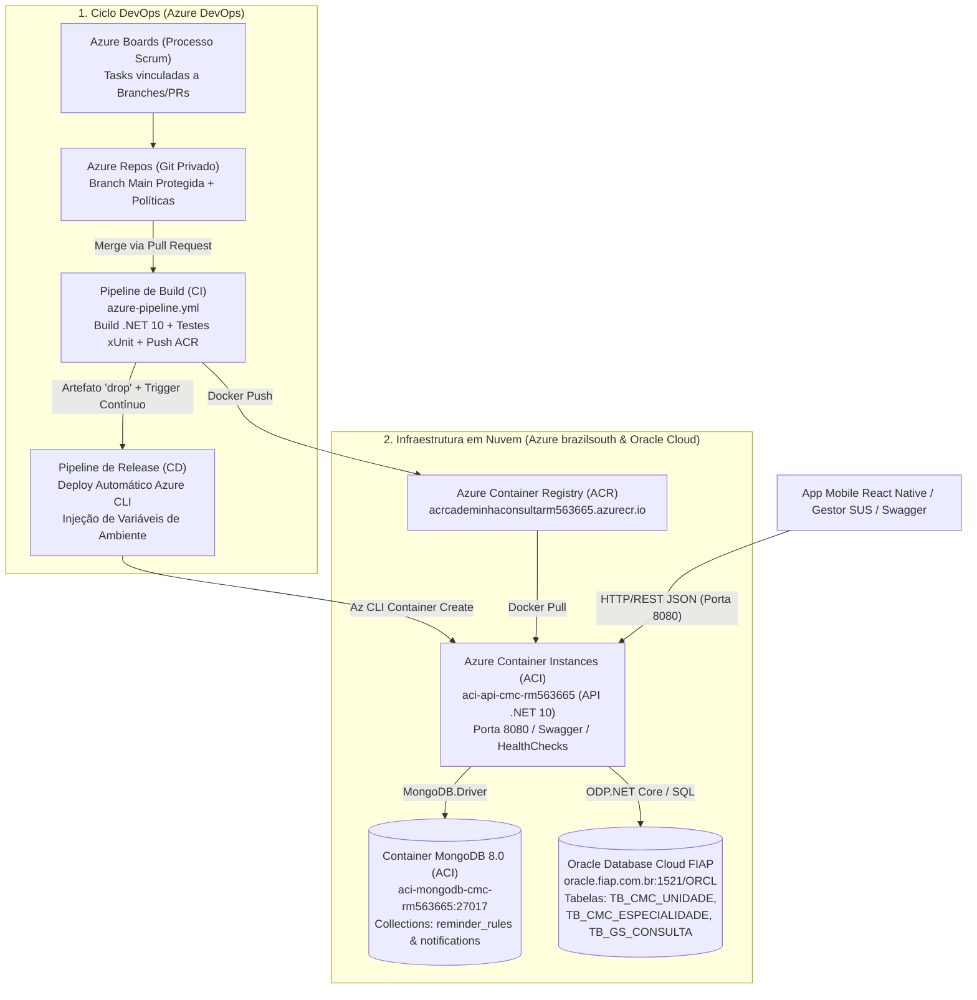

# Cadê Minha Consulta — Solução CitizenTech (.NET 10, DevOps & Cloud Computing)

**FIAP • 2º Ano Análise e Desenvolvimento de Sistemas • Global Solution 2026/2 (CitizenTech)**  
**Disciplinas Integradas:** DevOps Tools & Cloud Computing • Advanced Business Development with .NET • Compliance, Quality Assurance & Tests • Mastering Relational and Non-Relational Database  
**Grupo:** Celtics Tech

## 1. Identificação da Equipe (Grupo Celtics Tech)

| Nome Completo do Integrante | RM | Turma | Papel no Projeto |
| :--- | :---: | :---: | :--- |
| **João Victor Vendrameto** | 563665 | 2TDSPV | Cloud & DevOps Engineer / QA Lead |
| **Gabriel Ambrósio Saraiva** | 566552 | 2TDSPV | Scrum Master / Arquitetura & Documentação |
| **Vinicius Romaguera Cardozo** | 562308 | 2TDSPX | Backend Developer / Modelagem de Dados |
| **Nicolas de Oliveira Jacob** | 564205 | 2TDSPX | Backend Developer / Fluxos de Regulação |
| **Yuri Fuzinatto Garzoli Barreto** | 561450 | 2TDSPX | .NET Lead Developer / Segurança JWT & Testes xUnit |

* **Organização no Azure DevOps:** `https://dev.azure.com/rm563365`
* **Projeto Oficial DevOps:** `https://dev.azure.com/rm563365/CadeMinhaConsulta-DevOps`

---

## 2. Conceito da Solução CitizenTech e Problema Resolvido (ODS 3 e ODS 10)

A plataforma **Cadê Minha Consulta** é uma solução **CitizenTech** voltada à redução do absenteísmo em consultas e exames especializados da rede pública de saúde (**SUS**) e ao reaproveitamento automático de vagas ociosas em tempo hábil:
* **Problema Real:** O não comparecimento (absenteísmo) atinge entre 25% e 38% dos agendamentos ambulatoriais do SUS, causado principalmente pelo desconhecimento da data agendada (61,2%), esquecimento (23,5%), falta de transporte (29,0%) ou falha de contato por telefone desatualizado (14,5%).
* **Benefício ao Cidadão e ao Gestor Público:** A solução oferece confirmação antecipada com 1 toque, atualização cadastral rápida, liberação remota de vaga com preservação do encaminhamento, motor de regras de lembrete com idempotência, notificações sincronizadas e gestão de unidades de saúde e especialidades médicas da tabela SUS/SIGTAP.
* **Conexão com a Agenda 2030 da ONU:** **ODS 3** (Saúde e Bem-Estar) e **ODS 10** (Redução das Desigualdades).

---

## 3. Desenho Macro da Arquitetura (DevOps & Cloud Computing)

A arquitetura foi projetada em nuvem utilizando **Microsoft Azure (ACR + ACI)** integrado ao **Oracle Database Cloud (FIAP)** e ao **MongoDB 8.0 em Container (ACI)**, com ciclo completo de **CI/CD automatizado no Azure DevOps**:

### 3.1 Diagrama de Arquitetura e Fluxo CI/CD (Visualização Direta)

```text
+---------------------------------------------------------------------------------------------------+
|                             1. CICLO DEVOPS (AZURE DEVOPS - RM563365)                             |
|                                                                                                   |
|  +----------------------+      +-------------------------+      +------------------------------+  |
|  |     AZURE BOARDS     | ---> |       AZURE REPOS       | ---> |     AZURE PIPELINES (CI)     |  |
|  | - Work Items (Scrum) |      | - Git Privado           |      | - Build .NET 10.0 SDK        |  |
|  | - Tasks Vinculadas   |      | - Branch Main Protegida |      | - Testes Automáticos (xUnit) |  |
|  |   a Branches e PRs   |      | - Pull Request + Merge  |      | - Docker Build & Push p/ ACR |  |
|  +----------------------+      +-------------------------+      | - Publica Artefato (drop)    |  |
|                                                                 +--------------+---------------+  |
|                                                                                |                  |
|                                                                      Gatilho Automático (CD)      |
|                                                                                v                  |
|                                                                 +------------------------------+  |
|                                                                 |   AZURE PIPELINES (RELEASE)  |  |
|                                                                 | - Deploy Automático via      |  |
|                                                                 |   Azure CLI + Env Variables  |  |
|                                                                 +--------------+---------------+  |
+--------------------------------------------------------------------------------|------------------+
                                                                                 |
                                                                                 v
+---------------------------------------------------------------------------------------------------+
|                     2. INFRAESTRUTURA EM NUVEM (MICROSOFT AZURE & ORACLE CLOUD)                   |
|                         Resource Group: rg-cademinhaconsulta-gs (brazilsouth)                     |
|                                                                                                   |
|  +----------------------------------+            +---------------------------------------------+  |
|  |   AZURE CONTAINER REGISTRY (ACR) | ---------> |      AZURE CONTAINER INSTANCES (ACI)        |  |
|  |   acrcademinhaconsultarm563665   |  Pull Img  |      Container: aci-api-cmc-rm563665        |  |
|  | - Repositório:                   |            | - ASP.NET Core 10 Minimal API (Porta 8080)  |  |
|  |   cademinhaconsulta-api:latest   |            | - Swagger OpenAPI / JWT RS256 / Rate Limit  |  |
|  +----------------------------------+            +------+-------------------------------+------+  |
|                                                         |                               |         |
|                                     ODP.NET / EF Core   |                               | Driver  |
|                                     (Porta 1521 - TCP)  |                               | (27017) |
|                                                         v                               v         |
|                              +------------------------------------+   +------------------------+  |
|                              |     ORACLE DATABASE CLOUD FIAP     |   |  AZURE ACI (MONGODB 8) |  |
|                              |      oracle.fiap.com.br (ORCL)     |   | aci-mongodb-cmc-rm563665|  |
|                              | - TB_CMC_UNIDADE (CRUD Completo)   |   | - Collection:          |  |
|                              | - TB_CMC_ESPECIALIDADE (CRUD)      |   |   reminder_rules (CRUD)|  |
|                              | - TB_GS_CONSULTA (Leitura/Status)  |   | - Collection:          |  |
|                              +------------------------------------+   |   notifications        |  |
|                                                                       +------------------------+  |
+---------------------------------------------------------------------------------------------------+
                                                         ^
                                                         | HTTPS / REST JSON
                                           +-------------+-------------+
                                           |   CONSUMIDORES / CLIENTES |
                                           | - App Mobile React Native |
                                           | - Painel Gestor SUS       |
                                           | - Swagger UI / Postman    |
                                           +---------------------------+
```



### 3.2 Legenda e Fluxo Detalhado dos Componentes da Arquitetura

| Camada / Componente | Tecnologia / Recurso em Nuvem | Responsabilidade no Fluxo da Solução |
| :--- | :--- | :--- |
| **1. Gestão Ágil (Boards)** | Azure Boards (Processo Scrum) | Rastreabilidade ponta a ponta: toda alteração nasce em uma *Task*, que é vinculada à *Branch*, ao *Commit* (`#ID`) e ao *Pull Request*. |
| **2. Versionamento (Repos)** | Azure Repos (Git Privado) | Código-fonte com branch `main` protegida por políticas: revisor obrigatório (RM563665), vínculo obrigatório de Work Item e autoaprovação habilitada para simulação. |
| **3. Integração Contínua (CI)** | Azure Pipelines (`azure-pipeline.yml`) | Acionada exclusivamente após *Merge* na `main` via PR. Restaura pacotes, compila em `.NET 10.0`, executa os **47 testes automatizados xUnit**, faz *build/push* da imagem Docker para o ACR e publica o artefato `drop`. |
| **4. Entrega Contínua (CD)** | Azure Release Pipelines | Acionada automaticamente (*Continuous Deployment Trigger*) assim que a CI gera um novo artefato. Executa script Azure CLI atualizando o container da API no ACI com variáveis seguras. |
| **5. Registro de Imagens** | Azure Container Registry (`ACR`) | Armazena de forma privada e versionada as imagens Docker da aplicação (`cademinhaconsulta-api:$(Build.BuildId)` e `:latest`). |
| **6. Aplicação Backend** | Azure Container Instances (`ACI`) | Hospeda a API **ASP.NET Core 10 Minimal API** em container Linux na nuvem (`brazilsouth`), expondo o Swagger (`/swagger`), Health Checks (`/health/live` e `/health/ready`) e endpoints REST. |
| **7. Banco de Dados Relacional** | Oracle Database Cloud (`ORCL`) | Persistência relacional em nuvem das tabelas **`TB_CMC_UNIDADE`** (Unidades UBS/AME), **`TB_CMC_ESPECIALIDADE`** (Especialidades SIGTAP/SUS) e **`TB_GS_CONSULTA`**, com validação via `SELECT` direto no banco. |
| **8. Banco de Dados NoSQL** | MongoDB 8.0 em Container (`ACI`) | Persistência orientada a documentos em nuvem para as coleções **`reminder_rules`** (regras de lembrete com controle de idempotência) e **`notifications`**. |

---

## 4. Estrutura Oficial de Pastas do Repositório

O repositório segue estritamente a organização exigida pela disciplina de **DevOps Tools & Cloud Computing**:

```text
CadeMinhaConsulta-DevOps/
├── azure-pipeline.yml                         # Pipeline oficial de CI (Build, Testes xUnit, Push ACR e Artefato)
├── CadeMinhaConsulta.slnx                     # Solução .NET 10.0
├── README.md                                  # Documentação geral, Arquitetura Macro e JSONs de CRUD
├── .gitignore                                 # Proteção contra versionamento de segredos e binários
├── dockerfiles/                               # Pasta obrigatória de containerização (Requisito 12)
│   └── Dockerfile                             # Multi-stage build (.NET 10.0 SDK -> ASP.NET Core 10.0 Runtime)
├── scripts/                                   # Pasta obrigatória de scripts de banco e nuvem (Requisitos 09, 10 e 11)
│   ├── script-bd.sql                          # DDL das tabelas Oracle, carga inicial e SELECTs de validação
│   ├── provisionar-infra.azcli                # Script Azure CLI para criação de RG, ACR e Containers ACI
│   └── crud-tabelas.json                      # Massa de dados JSON pronta para execução dos CRUDs
├── src/
│   └── CadeMinhaConsulta.Api/                 # Projeto principal ASP.NET Core 10 Minimal API
│       ├── Program.cs                         # Configuração de DI, Swagger, Rate Limiting, JWT, HealthChecks e Rotas
│       ├── Features/
│       │   ├── OracleCrud/                    # CRUD completo de 2 tabelas relacionais no Oracle (Unidades e Especialidades)
│       │   ├── ReminderRules/                 # CRUD idempotente de Regras de Lembrete no MongoDB
│       │   └── Notifications/                 # Sincronização e leitura de Notificações de Consultas
│       └── Infrastructure/                    # Contexto EF Core Oracle, Stores MongoDB, HealthChecks e Autenticação JWT
└── tests/
    └── CadeMinhaConsulta.InfrastructureTests/ # Suíte com 47 testes automatizados xUnit executados no CI
```

---

## 5. Payloads JSON para Execução do CRUD e Comprovação com `SELECT` no Banco

Em cumprimento aos **Requisitos 14, 15 e 19** da disciplina de DevOps, a API expõe o CRUD completo (**Create, Read, Update, Delete**) em **duas tabelas relacionais no banco Oracle em nuvem** (`TB_CMC_UNIDADE` e `TB_CMC_ESPECIALIDADE`), além da coleção NoSQL no MongoDB (`reminder_rules`).

### 5.1 Tabela 1 (Oracle Cloud): `TB_CMC_UNIDADE` — Endpoint: `/api/unidades`

#### 1) CREATE — `POST /api/unidades`
* **Request Body (JSON):**
```json
{
  "nome": "AME Vila Mariana",
  "cnes": "2089123",
  "cidade": "São Paulo",
  "uf": "SP"
}
```
* **Response Esperado (`201 Created`):**
```json
{
  "id": 2,
  "nome": "AME Vila Mariana",
  "cnes": "2089123",
  "cidade": "São Paulo",
  "uf": "SP",
  "criadoEm": "2026-11-18T14:00:00Z"
}
```

#### 2) READ — `GET /api/unidades` e `GET /api/unidades/{id}`
* **Response Esperado (`200 OK`):** Retorna a lista completa de unidades ou o JSON da unidade consultada pelo `id`.

#### 3) UPDATE — `PUT /api/unidades/{id}` (Ex.: `PUT /api/unidades/2`)
* **Request Body (JSON):**
```json
{
  "nome": "AME Vila Mariana - Unidade Integrada SUS",
  "cnes": "2089123",
  "cidade": "São Paulo",
  "uf": "SP"
}
```
* **Response Esperado (`200 OK`):** Retorna o objeto JSON com o campo `nome` atualizado.

#### 4) DELETE — `DELETE /api/unidades/{id}` (Ex.: `DELETE /api/unidades/2`)
* **Response Esperado:** `204 No Content`.

#### 5) Comprovação Direta no Banco de Dados (Oracle SQL Developer)
```sql
SELECT ID_UNIDADE, NM_UNIDADE, CD_CNES, NM_CIDADE, SG_UF, DT_CRIACAO
FROM TB_CMC_UNIDADE
ORDER BY ID_UNIDADE;
```

---

### 5.2 Tabela 2 (Oracle Cloud): `TB_CMC_ESPECIALIDADE` — Endpoint: `/api/especialidades`

#### 1) CREATE — `POST /api/especialidades`
* **Request Body (JSON):**
```json
{
  "nome": "Ortopedia Adulto",
  "codigoSigtap": "0301010072",
  "valorSigtap": 10.79,
  "idUnidade": 1
}
```
* **Response Esperado (`201 Created`):**
```json
{
  "id": 2,
  "nome": "Ortopedia Adulto",
  "codigoSigtap": "0301010072",
  "valorSigtap": 10.79,
  "idUnidade": 1,
  "criadoEm": "2026-11-18T14:05:00Z"
}
```

#### 2) READ — `GET /api/especialidades` e `GET /api/especialidades/{id}`
* **Response Esperado (`200 OK`):** Retorna a lista de especialidades médicas vinculadas às unidades de saúde.

#### 3) UPDATE — `PUT /api/especialidades/{id}` (Ex.: `PUT /api/especialidades/2`)
* **Request Body (JSON):**
```json
{
  "nome": "Ortopedia e Traumatologia Especializada",
  "codigoSigtap": "0301010072",
  "valorSigtap": 90.36,
  "idUnidade": 1
}
```
* **Response Esperado (`200 OK`):** Retorna o JSON atualizado com o novo nome e valor contratado (`90.36`).

#### 4) DELETE — `DELETE /api/especialidades/{id}` (Ex.: `DELETE /api/especialidades/2`)
* **Response Esperado:** `204 No Content`.

#### 5) Comprovação Direta no Banco de Dados (Oracle SQL Developer)
```sql
SELECT ID_ESPECIALIDADE, NM_ESPECIALIDADE, CD_SIGTAP, VL_SIGTAP, ID_UNIDADE, DT_CRIACAO
FROM TB_CMC_ESPECIALIDADE
ORDER BY ID_ESPECIALIDADE;
```

---

### 5.3 Tabela/Coleção 3 (MongoDB em Nuvem): `reminder_rules` — Endpoint: `/api/reminder-rules`

*(Requer autenticação Bearer JWT com papel `GESTOR` e cabeçalho `Idempotency-Key: demo-regra-1` no `POST`)*

* **CREATE (`POST /api/reminder-rules`):**
```json
{
  "name": "Lembrete Antecipado 48h SUS",
  "daysBefore": 2,
  "message": "Confirme sua presença na consulta pelo aplicativo Cadê Minha Consulta.",
  "isActive": true
}
```
* **UPDATE (`PUT /api/reminder-rules/{id}`):**
```json
{
  "name": "Lembrete Antecipado 24h SUS - Urgente",
  "daysBefore": 1,
  "message": "Sua consulta é amanhã! Confirme com 1 toque ou libere a vaga para a fila.",
  "isActive": true
}
```
* **READ (`GET /api/reminder-rules`)** e **DELETE (`DELETE /api/reminder-rules/{id}`)**.

---

## 6. Variáveis de Ambiente Configuradas nas Pipelines (Requisito 15)

Nenhuma senha ou string de conexão sensível é armazenada no código-fonte. As Pipelines de Build (CI) e Release (CD) injetam as configurações de forma segura:

| Variável na Pipeline / Container | Finalidade |
| :--- | :--- |
| `ACR_LOGIN_SERVER` | Servidor do Azure Container Registry (`acrcademinhaconsultarm563665.azurecr.io`) |
| `ACR_USERNAME` / `ACR_PASSWORD` | Credenciais seguras para *push* e *pull* da imagem Docker no ACR (Secret) |
| `RESOURCE_GROUP` | Grupo de recursos na nuvem Azure (`rg-cademinhaconsulta-gs`) |
| `ConnectionStrings__Oracle` | String de conexão ODP.NET para o banco Oracle Cloud FIAP (Secret) |
| `Oracle__Schema` | Schema proprietário das tabelas no Oracle (`RM561450` / `RM563665`) |
| `ConnectionStrings__Mongo` | URI do container MongoDB 8.0 no Azure ACI (`mongodb://cmc-mongo-rm563665.brazilsouth.azurecontainer.io:27017`) |
| `Mongo__Database` | Nome do database NoSQL em nuvem (`cademinhaconsulta_prod`) |
| `ASPNETCORE_ENVIRONMENT` | Ambiente de execução do container (`Development` para habilitar interface Swagger UI em nuvem) |
| `RateLimiting__PermitLimit` | Limite de requisições por minuto por usuário autenticado (Padrão: `60`, retornando `HTTP 429`) |

---

## 7. Execução Local e Testes Automatizados (xUnit)

Para compilar a solução e executar os **47 testes automatizados (xUnit)** localmente via terminal:

```powershell
dotnet restore CadeMinhaConsulta.slnx
dotnet build CadeMinhaConsulta.slnx --configuration Release --no-restore
dotnet test CadeMinhaConsulta.slnx --configuration Release --no-build
```