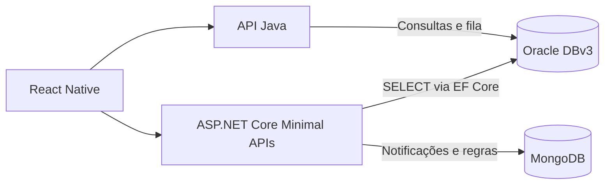

# Arquitetura do Cadê Minha Consulta .NET

| Componente | Responsabilidade |
|---|---|
| Minimal APIs | Validar as requisições, aplicar JWT por perfil e titularidade, limitar requisições por identidade e servir OpenAPI em desenvolvimento. |
| Oracle DBv3 | Origem dos dados de consultas. A API .NET lê somente as consultas necessárias ao titular e não aplica migrations. |
| MongoDB | Persistir notificações, marcações de leitura e regras de lembrete. O índice único `_id_` garante que o mesmo evento de negócio ou comando idempotente tenha um único documento. |
| React Native | Chamar as APIs conforme o fluxo, enviar o JWT e atualizar a tela conforme os resultados. |

O GET de notificações consulta o estado atual no Oracle, registra no MongoDB apenas combinações novas de paciente, consulta e status, e retorna o histórico observado. A marcação de leitura usa exclusivamente MongoDB. O POST de regras preserva a resposta original junto com a regra em uma única gravação atômica.

A API valida tokens localmente. Os tokens de demonstração usam um emissor exclusivo de `Development`. O contrato de produção com Java deve definir emissor, audiência, chave pública, perfis e claim de titularidade. O [contrato Mobile](Contrato-Mobile.md) descreve as chamadas e a [configuração Oracle](Oracle-DBv3.md) descreve o acesso local.
